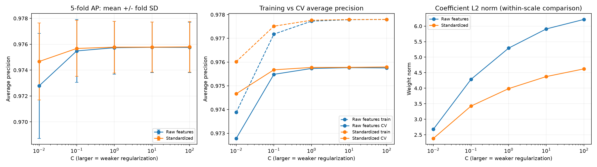
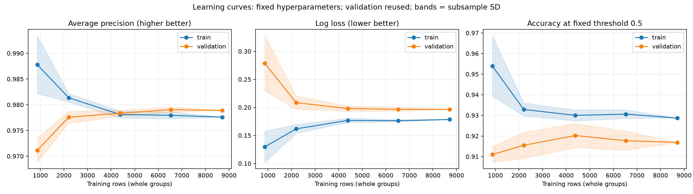
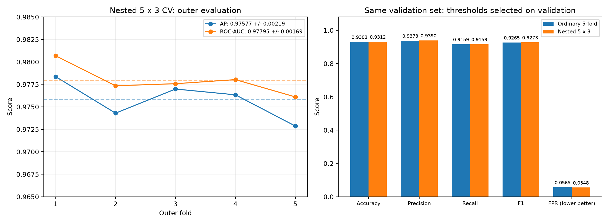
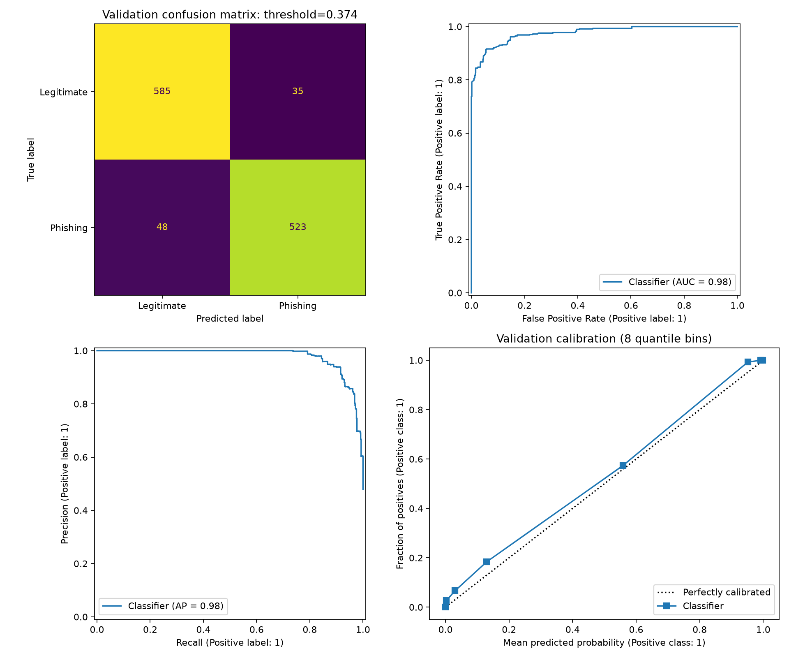
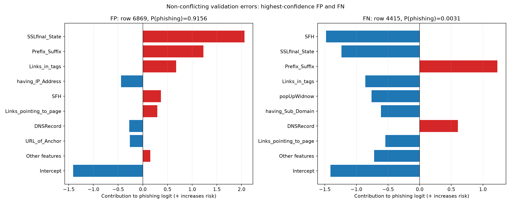

# 實驗結果與討論

> 本文件為研究報告初稿。本文呈現交叉驗證、驗證集分析及固定模型的測試重評。測試集曾於歷史探索中被查看，本次不屬全新未接觸的獨立驗證。

## 一、實驗設計

本研究使用 UCI Phishing Websites 資料集，共 11,055 筆樣本與 30 個輸入特徵，並將釣魚網站定義為正類。

資料包含 5,206 筆整列重複資料，以及 64 組特徵相同但標籤不同的組合。因此，本研究依全部 30 個特徵建立群組，將相同特徵組合分配至同一資料集，避免其同時出現在訓練與評估資料中。

資料分為訓練集 8,711 筆、驗證集 1,191 筆及測試集 1,153 筆。標準化置於 Pipeline 內，只從各次訓練部分估計參數。驗證集用於選擇分類門檻，目前主流程預設不評估測試集。

## 二、基準模型比較

基準模型使用訓練集多數類別分類器。由於訓練集合法網站較多，此模型對所有樣本均預測為合法。原始隨機森林僅保留為前期探索紀錄，不作為本報告的正式基準。

| 驗證集指標 | 多數類別基準 | L2 邏輯斯迴歸（普通五折） |
|---|---:|---:|
| Accuracy | 52.06% | 93.03% |
| 釣魚 Recall | 0% | 91.59% |
| F1 | 0 | 0.9265 |
| FPR | 0% | 5.65% |

基準模型雖無誤報，卻漏判所有釣魚網站。L2 邏輯斯迴歸在驗證集中辨識出 571 個釣魚網站中的 523 個，顯示其已學到具有辨識能力的特徵關係。基準模型沒有預測正類時，Precision 依 zero_division=0 記為 0。

## 三、正則化與學習曲線

本研究比較 C＝0.01、0.1、1、10、100，以及是否標準化，以訓練集內五折 Average Precision 選擇設定。

普通五折流程選出標準化與 C＝100，平均 AP 為 0.975795；標準化與 C＝1 的 AP 為 0.975773，差異僅約 0.000022。因此，C＝100 為本次候選中的最高分設定，但沒有充分證據認定其明顯優於 C＝1。



學習曲線顯示，隨訓練資料增加，訓練與驗證表現差距縮小，未觀察到嚴重過擬合的明顯跡象。後半段驗證表現趨於平穩，但僅憑此現象，無法確認模型是否欠擬合。



學習曲線固定已選出的超參數，使用三個亂數種子抽取完整訓練群組，重複評估同一驗證集。陰影為子抽樣結果的標準差，非信賴區間。圖中的 Accuracy 使用固定門檻 0.5，與驗證集選出的約 0.3737 門檻不同。

## 四、巢狀交叉驗證

為評估選模流程，本研究另在訓練集內執行外層五折、內層三折的巢狀分組交叉驗證。外層結果如下：

| 指標 | 五折平均 ± 樣本標準差 |
|---|---:|
| Average Precision | 0.97577 ± 0.00219 |
| ROC-AUC | 0.97795 ± 0.00169 |

各折選出的 C 與縮放方式略有差異，但評估分數波動不大。五折樣本標準差使用 ddof=1，不代表信賴區間。外層只計算不依賴分類門檻的 AP 與 ROC-AUC；最終設定另以完整訓練集三折搜尋，再用獨立驗證集選門檻。

最終巢狀流程在獨立驗證集的 Accuracy 為 93.12%，比普通五折多判對一個合法網站，漏判數皆為 48 筆。因此，不能認定巢狀流程明顯改善分類表現；其主要價值為提供選模流程的外層評估。



## 五、誤判分析

普通五折模型在驗證集中產生 35 筆誤報與 48 筆漏判，共 83 筆錯誤。其中 31 筆屬於衝突標籤群組。這些衝突可能來自特徵離散化、資訊不足或資料品質問題，不能直接認定為標籤錯誤。

| 實際類別／預測類別 | 合法 | 釣魚 |
|---|---:|---:|
| 合法 | 585 | 35 |
| 釣魚 | 48 | 523 |



在非衝突群組中，亦觀察到高信心誤判。例如，一筆合法樣本（原始資料零起算索引 6869）的預測釣魚機率為 91.56%，主要受到 SSLfinal_State、Prefix_Suffix 與 Links_in_tags 的正向 logit 貢獻影響；另一筆釣魚樣本（索引 4415）的預測機率僅為 0.31%，主要受到 SFH、SSLfinal_State 等特徵的負向貢獻影響。



圖中貢獻為標準化特徵乘上模型權重，單位是 logit，並非機率百分比。上述案例顯示，合法與釣魚網站可能具有相似的局部特徵。特徵貢獻可解釋模型如何計算分數，但不代表真實因果關係，也不足以確認標籤是否正確。

## 六、研究限制

驗證集同時用於選擇門檻與開發分析，因此其成績不應視為無偏的最終測試表現。歷史探索曾比較同一測試集上的多種流程，此事亦需如實揭露。

此外，資料缺少原始網址、網域 ID 與時間戳記。群組切分只能確保相同特徵組合不跨集，不能保證網域或時間上的獨立性，結果也不代表模型可直接辨識現今未知網站。

## 七、固定模型的測試重評

在完成主方法選擇後，直接載入既有普通五折模型，固定 C=100、標準化與驗證門檻約 0.3737，不重新訓練或調參。多數類別基準仍僅依訓練集決定預測類別。兩者在相同 1,153 筆測試資料上比較。

| 測試指標 | 多數類別基準 | L2 邏輯斯迴歸 |
|---|---:|---:|
| Accuracy | 0.6071 | 0.9245 |
| Precision | 0.0000 | 0.8675 |
| Recall | 0.0000 | 0.9536 |
| F1 | 0.0000 | 0.9085 |
| FPR | 0.0000 | 0.0943 |
| ROC-AUC | 0.5000 | 0.9805 |
| Average Precision | 0.3929 | 0.9736 |

主模型混淆矩陣為 TN=634、FP=66、FN=21、TP=432；多數類別基準將 700 個合法網站判對，但漏判全部 453 個釣魚網站。主模型明顯優於此簡單基準，但仍有漏判與誤報。

本次只是固定流程後的重評；因同一測試集曾於前期方法探索中被查看，結果不能描述成完全未接觸資料上的確認性證據。評估後不依這些測試分數調整模型。

明確重現此評估可執行 `python src/evaluate_fixed_models.py`，它只載入已保存模型，不重新訓練。結果存於 `results/final_comparison/metrics.json`，日常 `make train` 仍不評估測試集。

## 重現與資料來源

在專案根目錄執行：

```bash
make setup
make check
make train
make baseline
make nested
make plots
make regularization
make compare
make cases
```

執行會覆寫各自輸出資料夾中的同名產物。上述指令不啟用最終測試評估。圖檔為本機生成，若僅複製此 Markdown，需一併攜帶相對路徑中的圖檔。

- [UCI Phishing Websites 資料集](https://archive.ics.uci.edu/dataset/327/phishing+websites)
- [專案資料引用、轉換與授權說明](data/README.md)
- 普通五折結果：`results/holdout80/metrics.json`
- 多數類別基準：`results/baseline/metrics.json`
- 巢狀交叉驗證結果：`results/nested_main/metrics.json`
